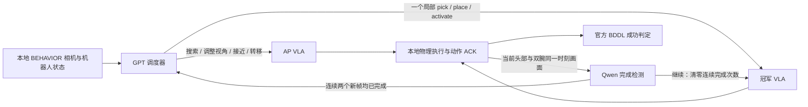

# SeekAct — 主动感知与交互 VLA 调度系统

SeekAct 将 **GPT 调度、主动感知 AP VLA、冠军交互 VLA 和 Qwen 视觉完成检测**整合在同一个仓库。GitHub 仓库名保留 `Kouyouyi/behavior-harness`，系统名称统一为 **SeekAct**。

仿真环境仍是独立项目：[Kouyouyi/behavior-ap](https://github.com/Kouyouyi/behavior-ap)。本仓库包含调度、VLA 推理服务、AP 数据处理与训练、冠军上游训练代码、实验审计和视频工具；**不包含模型权重、原始数据集、Isaac/BEHAVIOR 资产或访问凭据**。不需要克隆旧的本机 Agent 目录。

## 1. 系统怎样工作



- **GPT**：读取当前画面、选择 AP 或冠军、指定当前局部交互目标、处理恢复和安全问题。当前配置请求 `gpt-6-astra`、`low`、Fast；实际服务端优先级未验证。模型名称可通过原生会话配置覆盖。
- **AP**：原 `checkpoint_024000`，负责搜索、视角调整、接近和物体之间的移动。只接受训练覆盖的定性语义组合，不是任意机器人指令执行器。
- **冠军 VLA**：公开的 2025 BEHAVIOR Challenge 冠军 π0.5/OpenPI 改进模型，使用固定任务 ID，**不理解 GPT 的自由语言**。`interaction_goal` 交给完成检测器，不是冠军模型的语言输入。
- **Qwen**：每批冠军动作结束后，输入当前时刻头部与双腕的 RGB 拼图和一个局部交互描述。每个请求只有这一帧与描述，不附历史帧、历史答案、关节状态或 BDDL 信息；只接受 `继续` / `已完成`。连续两个物理步号递增的新帧都回答 `已完成`，立即结束冠军 job，交回 GPT；再次调用冠军前必须先执行 AP 并建立新交接。
- **成功依据**：Qwen 的“已完成”、GPT 的判断、物体距离或夹爪闭合均不能代替官方 BDDL。抓取/放置判断仍可能有视觉误判，需要通过结果和视频评估。

### 控制和时间契约

| 项目 | 当前接口 |
|---|---|
| 原始机器人观测 | 61 维 proprio + head / left_wrist / right_wrist 三路 RGB |
| AP 训练状态 | 从 61 维中选择 25 维，按随 checkpoint 提供的统计归一化 |
| AP 推理输出 | 32×23 原生 R1Pro 动作，每次只执行前 8 步，再取新观测 |
| 冠军推理输出 | 原公开 wrapper 的 20×23 动作，保留发布版阶段跟踪、拼接与修正规则 |
| Qwen 检查频率 | 每个冠军 chunk 后，即最多每 20 个物理控制步检查一次；不是每个渲染帧检查 |
| 调用等待 | 冻结物理；瞬时网络错误持续重试，同一请求不会重复执行动作 |
| 本轮协议总预算 | 三任务模板取消总物理步数和任务墙钟超时；连接超时只用于重试 |
| 可终止条件 | 官方成功、真实环境终止、用户取消或有证据的安全/基础设施阻塞 |
| 原生直接控制 | 实现保留，但严格 VLA 调度模式中隐藏并由 worker 硬拒绝 |

AP 介入后会清空冠军 wrapper 的时间上下文，以避免复用失效动作尾部；目前也会重置其阶段历史。该保守处理会影响长任务连续性，应作为后续改进点，而不是宣称已经解决。

## 2. 目录

```text
seekactctl                         # 公开命令：doctor / prepare / run / test
seekact/                           # SeekAct Agent 与工具系统
  harness/codex_cli/behavior.py     # GPT/Codex 观察与调度循环
  services/behavior_ap/             # 本地 worker、AP/冠军客户端、Qwen 检测、动作审计
  scripts/                         # 三任务实验、校准、报告、视频审计
  agent_skills/                    # 原工具/技能实现与使用说明
  local_tests/unit/                # 控制边界、切换、传输、视频回归测试
configs/seekact/three_tasks.json    # 可移植的三任务模板，不含密钥
remote_ap/                         # AP 训练、索引处理、权重元信息及推理入口
remote_champion/                   # 冠军推理/训练入口与校验下载工具
third_party/champion/              # 冠军实际兼容源码、训练脚本和 Apache-2.0 许可
  openpi/                          # 对应 OpenPI 源码和 openpi-client
pi05_harness_20261017/              # 已有 AP 推理运行时、LeRobot 实现、tokenizer
ap_harness/ scripts/ configs/       # 原 harness/历史场景与评测工具，兼容保留
```

旧 harness 使用说明保留在 [LEGACY_HARNESS.md](docs/LEGACY_HARNESS.md)。新系统从 `./seekactctl` 开始使用；旧入口不会自动变成 Qwen 协议。原框架包含其他机器人适配代码，仅作工具实现保留，当前主线测试是 BEHAVIOR R1Pro。

## 3. 机器分工与准备

推荐分为：

1. **本地仿真主机**：NVIDIA GPU、Isaac Sim、OmniGibson、官方 BEHAVIOR 资产、独立 `behavior-ap`、SeekAct worker 和已登录的 Codex CLI。
2. **远程推理/训练主机**：AP PyTorch/LeRobot 环境和冠军 JAX/OpenPI 环境。**无需安装 Isaac**。可以是 `huoshan`，也可替换成其他机器。
3. **Qwen 服务**：OpenAI 兼容的视觉 `/v1/models`、`/v1/chat/completions`，必须能从仿真主机访问。

AP 与冠军建议使用不同 Python 环境，避免 PyTorch/JAX、Transformers、LeRobot 版本冲突。仿真环境也单独安装。仓库中的 observed requirements 是实际机器版本记录，**不是保证适用于任意驱动的通用锁文件**。

### 获取代码与仿真依赖

```bash
git clone git@github.com:Kouyouyi/behavior-harness.git
cd behavior-harness

# 独立仿真项目；不下载资产，也不启动 Isaac
git clone git@github.com:Kouyouyi/behavior-ap.git ../behavior-ap
git -C ../behavior-ap checkout f99653f78f94fcb0547f9575c52019dc47fa8f6b
```

按 `../behavior-ap/README.md` 安装官方仿真依赖和授权资产，再在仿真 Python 中安装：

```bash
/path/to/behavior-python -m pip install --no-deps -e ../behavior-ap
```

资产根目录应含 `2026-challenge-task-instances`、`behavior-1k-assets`、`omnigibson-robot-assets`。当前独立仿真注册官方挑战 100 个任务的 ID 加载入口、7 套房屋布局和 32,000 个 train/public_test 实例；调好的注册 OOD 仍只有收音机。**下面三任务模板使用原始 public_test/301，不能当作新增 OOD 对照实验。**

本地 Agent 环境至少需要 Python3.11、Pillow、NumPy；视频与仿真测试另外需要 SciPy、OpenCV、PyAV、ffmpeg/ffprobe。Codex CLI 需要先在本机登录，SeekAct 不复制登录文件到仓库或实验目录。

```bash
python -m pip install -r requirements-seekact.txt
codex login
export SEEKACT_AGENT_PYTHON=/path/to/agent-python
export SEEKACT_SIM_PYTHON=/path/to/behavior-python
export SEEKACT_SIM_ROOT=$(realpath ../behavior-ap)
export BEHAVIOR_ASSET_ROOT=/path/to/BEHAVIOR-1K
export SEEKACT_GPU_LOCK=/tmp/seekact-gpu.lock
./seekactctl doctor
```

`doctor` 只检查配置和模块导入，不创建仿真场景、不发送动作。若源资产必须提权访问，可显式设置 `SEEKACT_SUDO_HELPER=/path/to/your-controlled-helper.sh`；默认不使用当前作者机器的 sudo helper，不保存密码。helper 必须接受命令 argv 并保留调用者环境中的必要路径。其他项目共用 GPU 时请配置同一把锁。

## 4. 启动 AP 推理服务（远程）

代码、状态适配、归一化和 tokenizer 已在仓库中。AP 推理权重独立发布于 [ModelScope: YouyiKou/behavior-ap-pi05-checkpoint-024000](https://modelscope.cn/models/YouyiKou/behavior-ap-pi05-checkpoint-024000)。下载到自己的模型目录，不提交进 Git。

复用已安装好相容 PyTorch/Transformers 的 AP 环境，LeRobot 模块通过 `remote_ap/vendor` 的相对链接复用仓库内版本。版本记录见 [remote_ap/requirements-observed.txt](remote_ap/requirements-observed.txt)，详细接口见 [remote_ap/README.md](remote_ap/README.md)。

```bash
export AP_PYTHON=/path/to/ap-venv/bin/python
export AP_CHECKPOINT=/absolute/path/to/checkpoint_024000
export AP_PORT=18770
bash remote_ap/serve.sh
# 新终端检查：GET http://127.0.0.1:18770/health
```

返回中的 checkpoint 路径必须与本地 SeekAct 协议中的 `ap_checkpoint` 完全一致，不能只核对文件夹末尾名称。服务应返回有限的 `32×23` 动作。

## 5. 启动冠军 VLA（远程）

来源与对应技术报告：

- [开源实现](https://github.com/IliaLarchenko/behavior-1k-solution)
- [Task adaptation of Vision-Language-Action model: 1st Place Solution for the 2025 BEHAVIOR Challenge](https://arxiv.org/abs/2512.06951)

已纳入兼容源码：冠军提交 `ca556f74a455cef7987a2be4537b5ac85cc56dd7`，OpenPI 提交 `01177e0242a1c7e8fad2547caa0e987def614cda`，以及实际使用的状态适配补丁。上游许可与修改记录保留在 `third_party/champion/`，来源见 [SEEKACT_PROVENANCE.json](docs/SEEKACT_PROVENANCE.json)。

冠军需要独立 Python3.11/JAX 环境。按 [上游安装说明](third_party/champion/README.md) 安装依赖，项目根为 `third_party/champion`，其中 OpenPI/openpi-client 源码已包含。上游依赖仍需联网安装，PyTorch/JAX CUDA 版本按实际 GPU/驱动匹配。工作环境包版本记录在 [remote_champion/requirements-observed.txt](remote_champion/requirements-observed.txt)。

```bash
export CHAMPION_PYTHON=/path/to/champion-venv/bin/python
export CHAMPION_WEIGHTS=/absolute/path/to/behavior-2025-champion
# 下载 checkpoint_2，验证文件尺寸及可获得的 LFS SHA256，写 DOWNLOAD_VERIFIED.json
"$CHAMPION_PYTHON" remote_champion/download_weights.py
export CHAMPION_PORT=18778
bash remote_champion/serve.sh
```

权重固定 `IliaLarchenko/behavior_submission@89545bc1b7aa7f2e687bc0032d091f132d715d4e` 的 `checkpoint_2`。启动会先做 RGB/proprio 推理烟测，默认使用合成图像，**不代表任务成功**；可用 `--smoke-input /path/to/real_request.json` 检查真实输入。

当前专用服务开放匹配该 checkpoint 的任务：收音机0、鞋子22、picking_up_toys7、collecting_childrens_toys21；这不是任意100任务共享权重。发布版 task/checkpoint 表保留在 `third_party/champion/task_checkpoint_mapping.json`。旧服务 role 为旧系统标识，新入口使用 `seekact_champion_tools`，请成套部署客户端和服务端，不能混用。

服务只绑定 loopback，单活跃 episode。`episode/seq/context_epoch` 保证同一请求重试不会重复消费模型状态；服务状态变化需按新 attempt 处理，不能盲目续跑。并行 episode 需独立服务上下文。

### 转发到仿真主机

在本地另开终端：

```bash
ssh -N -L 18770:127.0.0.1:18770 -L 18778:127.0.0.1:18778 YOUR_INFERENCE_HOST
```

Qwen 如位于另一机器，也必须保证仿真主机能路由到该地址。不能因为远程模型已启动就假定本地能访问。

## 6. 配置 Qwen，跑三条任务

**密钥只放仓库外的私有文件**，设置权限600；不要放进命令行参数、Git、README 或实验 JSON。示例配置见 [.env.example](.env.example)。

```bash
mkdir -p "$HOME/.config/seekact"
# 用编辑器写入自己的 Qwen key，不要提交或回显它
chmod 600 "$HOME/.config/seekact/qwen_key"

./seekactctl prepare \
  --output "$PWD/outputs/seekact_three_01" \
  --qwen-base-url http://YOUR_QWEN_HOST:8000/v1 \
  --qwen-key-file "$HOME/.config/seekact/qwen_key" \
  --ap-checkpoint /absolute/path/reported/by/remote/ap/health

./seekactctl run --output "$PWD/outputs/seekact_three_01"
```

如 `/v1/models` 暴露多个模型，增加 `--qwen-model ACTUAL_SERVED_MODEL_ID`。模型必须支持当前 RGB 图像输入。prepare 只创建协议，不启动机器人；输出目录必须是新的，不覆盖旧试验。

默认三任务均为冠军原生支持，从独立初始场景开始，seed20261020、fast、public_test/301：

| ID | 任务 | 原任务目标 |
|---:|---|---|
| 22 | putting_shoes_on_rack | 将两只运动鞋和两只凉鞋放上走廊鞋架/玄关架，并按类型相邻摆放 |
| 0 | turning_on_radio | 将客厅桌上的收音机开启 |
| 21 | collecting_childrens_toys | 将骰子、玩具熊、火车和桌游收集到同一个书柜中 |

流程：等待 Qwen → 合成图像接口烟测 → AP/冠军真实 worker 校准 → 带 Qwen 的真实相机校准 → 三条全新任务 → ACK/动作/视频审计。校准不计任务成功率。若服务无法连接，等待状态会写入 `study_status.json`，不假装正式实验已启动。默认任务串行执行，不干扰其他 GPU 使用者。

每次冠军调用要给出**单个**局部目标，例如“拿起地面左侧的凉鞋，鞋离地且受夹爪支撑”或“将手中骰子释放到左书柜并留在其中”，不要把完整 pick-and-place 或多物体任务交给一个完成检测目标。

无全局预算不等于永不结束：真实环境终止、安全阻塞或用户取消仍会结束。Ctrl+C 只请求停止本次拥有的进程并封口证据；不能通过重放已提交动作恢复。基础设施修复后创建新输出/attempt，从初始场景重新运行，旧证据保留。

## 7. 结果、视频和验收

每个 trial 保存：

- `execution.jsonl`、`actions.npy`：每个动作的原始输入、控制器所有权、提交和 ACK。
- `vla/job_*/chunk_*`：请求、原始动作、实际执行前缀、观测与模型身份。
- `vla/job_*/qwen_*`：当前图像拼图、无历史请求、原始回复及规范化判定。
- `vla/qwen_checks.json`：连续判定及切换证据；`vla/summary.json` 保存完整调用和交接。
- `sim/videos/robot_cameras.mp4` 与 `third_person.mp4`：H264 全过程录像。
- `trial_record.json`、`episode_closed.json`：官方成功、退出原因、动作/视频完整性。
- 根目录 `index.html`、`vla_usage.json`、`execution_audit.json`、`final_acceptance.json`：汇总。

视频顶部青色放大镜为 AP，金色星形为冠军；每帧标注真实动作所有者，不根据任务阶段猜测。观测图像保持原样，标识只影响录制视频。完整视频逐帧解码并与动作数量核对。30fps 视频记录物理执行时间，不包含冻结的 GPT/Qwen/网络等待，墙钟时间另记。

浏览器若将 `file://` HTML 当源代码展示，请通过你自己的可信本地 HTTP 静态查看器打开结果，不要把 API key 或整个主目录暴露为静态目录。`seekact/scripts/serve_behavior_video_results.py` 是旧两任务的专用查看器，并非本轮通用入口。

**实验边界**：该仓库交付已经实现和测试的逻辑，不声称新克隆完成了真实三任务评测，更不保证开机、抓取或放置成功。Qwen 两次完成的机制可能仍误判；冠军不接受自由语言、AP 的动作语义覆盖也有限。网络等待/初始化错误必须和模型能力失败分开统计。

## 8. 训练 AP VLA

完整入口在 [remote_ap/README.md](remote_ap/README.md)。这里包含真实使用的训练、时间掩码、按 episode 划分、语义标签、时序过滤、状态/动作归一化和续训契约。原始数据不随仓库发布。

数据预期为已转换的 LeRobot v3 数据：`data/*/*.parquet`、三路 `videos/`、`meta/episodes/`，以及转换/语义标注阶段生成的 `_control/segments/data/*.jsonl` 等控制索引。**不是任意一个官方原始目录都能直接训练**；检查 `build_semantic_index.py` / `training_data.py` 的列名与路径。官方数据到该双语转换格式的上游资产需自行准备。

```bash
export AP_PYTHON=/path/to/ap-venv/bin/python
export AP_PROJECT_ROOT=/path/to/new/ap_work
export AP_RAW_DATA_ROOT=/path/to/converted_behavior_data
export AP_BASE_MODEL_PATH=/path/to/pi05_base
export AP_TRAINING_INDEX="$AP_PROJECT_ROOT/training_horizon_v2"
export AP_TOKENIZER_PATH="$PWD/remote_ap/tokenizer"
export PYTHONPATH="$PWD/remote_ap/vendor:$PWD/remote_ap/scripts"
mkdir -p "$AP_PROJECT_ROOT/reports" "$AP_PROJECT_ROOT/index" "$AP_PROJECT_ROOT/evaluation"

"$AP_PYTHON" remote_ap/scripts/build_semantic_index.py
"$AP_PYTHON" remote_ap/scripts/prepare_training.py
"$AP_PYTHON" remote_ap/scripts/audit_training_horizon.py
"$AP_PYTHON" remote_ap/scripts/build_horizon_filtered.py
bash remote_ap/train.sh --steps 30000 --batch-size 8 --accumulation 4 \
  --workers 4 --dtype float32 --memory-fraction 0.82 --run-name new_unique_run
```

这些步骤沿用真实数据审计的严格条件（含源分片数等），重建不同版本数据时应先审核，而不是删掉断言。数据处理脚本已添加环境变量路径覆盖，计算/划分逻辑不变。

当前 AP 模型的记录为 **99任务、31类语义组合、421,211训练窗口**；收音机任务留出，不参与 AP 训练。动作预测32步、执行8步；25维状态、23维动作；验证/测试按整条 episode 隔离，归一化来自训练集。配置快照见 `remote_ap/training_metadata/`，checkpoint 契约见 `active_checkpoint_metadata/`。

`--resume` 需完整训练 checkpoint，包括 optimizer/RNG 的 `training_state.pt` 和匹配的数据契约；公开推理包只有推理文件，不能精确恢复 Adam 状态。训练入口在写 checkpoint 前保留100GiB磁盘余量；请按实际可用显存与存储调整并记录配置，不照搬 batch8 到小显存机器。

## 9. 冠军 VLA 训练代码

冠军训练源码完整保留在 `third_party/champion/src/b1k/training/` 与 `scripts/train.py`；对应模型、数据加载、阶段标签、相关噪声和动作拼接也在同目录。

先按 [上游说明](third_party/champion/README.md) 准备数据、π0.5 基座、FAST tokenizer、相关性统计和 normalization assets，再配置 `src/b1k/training/config.py` 中数据与输出路径。使用独立、干净的训练输出，不能把 AP 的25维归一化统计直接交给冠军。

```bash
export CHAMPION_PYTHON=/path/to/champion-venv/bin/python
bash remote_champion/train.sh pi_behavior_b1k_fast \
  --batch_size=16 --num_train_steps=200000 \
  --save_interval=2000 --keep_period=10000 --log_interval=100
```

多卡 FSDP、统计计算与 FAST tokenizer 命令见上游 README。以上为上游启动示例，**本次代码整合没有重新训练冠军，也未证明重训会复现比赛成绩**。本系统使用的是固定公开 revision 的 checkpoint_2，不是自行重训后的权重。

## 10. 验证与开发

```bash
# 不启动 Isaac，不运行真实模型
./seekactctl --help
# 在有numpy/scipy/opencv/PyAV的测试环境里运行；独立仿真包需已安装
SEEKACT_AGENT_PYTHON=/path/to/test-python ./seekactctl test
python -m unittest discover -s tests -v  # 原 harness 的测试，另行使用其依赖
```

SeekAct 回归覆盖：原生控制禁用、AP语言组合、原始动作前缀、幂等传输、视觉交接、新帧判定、连续两次中断、继续清零、等待冻结物理、无隐含全局超时、视频标识与编码。运行校准前必须完成实际编码/解码检查。轻量测试不代替实时仿真。

不要在运行中的场景里换模型、改成功标准或放宽状态一致性检查。不要把历史基础设施 attempt 当能力失败，也不要选择性重跑凑成功率。新场景/OOD 必须单独校验并记录，不能只改自然语言就称 OOD。

## 11. 来源与许可

来源、提交号、适配与验证记录见 [SEEKACT_PROVENANCE.json](docs/SEEKACT_PROVENANCE.json) 和 [THIRD_PARTY_NOTICES.md](THIRD_PARTY_NOTICES.md)。第三方许可证、论文和作者归属保留，不因系统改名而重新授予权重、官方数据或仿真资产许可。原框架快照未发现顶层 LICENSE，不能据此推断为任意许可；第三方代码仍受原作者条款约束。
