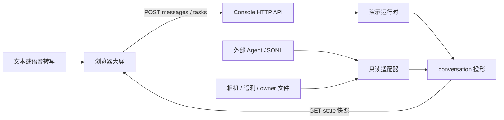
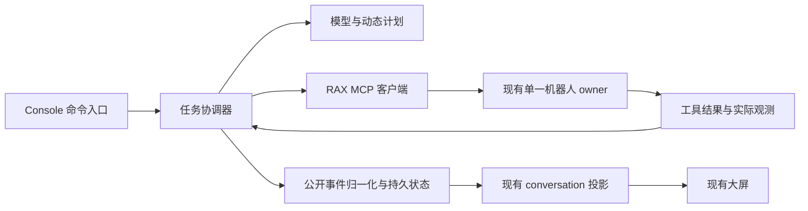

# Humanoid Agent 交接与接口说明

更新日期：2026-10-19。面向下一轮 Agent 子任务调度、工具调用和反馈闭环开发。

当前已完成 **Humanoid Agent / SeekAct Robotics 的展示界面、演示运行时、输入交互、只读事件接入和演示视频**。E115 进一步验证当前 Codex Agent 经 RAX MCP 调用家庭 VLA，完成750步/15秒实机米老鼠抓取，并将状态与结果投影到 UI；证据见[里程碑结果](evidence/E115/experiment-result.json)。展示服务本身仍不调用模型或机器人执行器。下一步需要实现常驻任务协调器，把网页用户指令接入这一执行链路。

本文中的“当前接口”均对应现有代码；“下一步设计”是尚未实现的接入建议。不要把演示工具名称和模拟成功结果当作实机能力。

## 1. 工作目录与当前交付

工作树：`/home/user/code/rax/worktrees/g1-sonic`，分支：`real/g1-sonic`。
父目录 `/home/user/code/rax` 不是本次界面实现的工作树。当前界面与VLA实机验证已纳入
里程碑标签 `g1-agent-vla-milestone-20261019`；下一轮基于该版本继续开发，保留本机
`runtime/` 与 `.local-runtime/` 内未入Git的完整实验日志。

| 交付 | 当前状态 |
| --- | --- |
| 品牌与大屏 | Humanoid Agent，首字母 H 大写；下方 SeekAct Robotics；1920×1080 基准画布，等比适配 16:9 和留边窗口 |
| 布局 | 顶部原始指令、状态、当前动作、用时；左上相机、左下全部 29 电机；右侧贯穿主体的会话与固定输入框 |
| 任务展示 | 顶部不写死子任务；计划在会话里随事件出现，支持待执行、执行中、完成、失败 |
| 对话 | 处理状态、公开判断摘要、工具参数、模拟返回、逐字输出；文本发送与最近会话历史 |
| 语音 | 浏览器中文语音转写到草稿，确认后发送；不自动提交；实际麦克风与在线识别服务未现场验收 |
| 温度 | 外壳 / 绕组双值，29 电机同时显示；黄红告警、踝部迟滞、故障标红、失效标灰 |
| 默认演示 | 脚本化的米老鼠桌面到沙发流程；42 秒，六个步骤；无模型推理、无身体运动 |
| 实机观测 | 只读文件适配：相机、DDS 采集结果、owner 状态、Agent JSONL 事件 |
| 实际 Agent 执行 | E115 已验证 Codex → MCP → VLA 15秒实机抓取；UI只读展示，网页自由文本执行尚未接通 |
| 配套视频 | 56.4 秒，1920×1080，30 fps，H.264 MP4，约 3.8 MB，无音轨，含品牌片头片尾 |

已验证：上一轮 53 项 Python 检查通过；浏览器录制验证六种工具模拟调用和返回、6/6 计划完成、模拟验收，无页面错误。MP4 已完整解码并抽查关键帧。这些检查不是实机任务验收。

界面交接初版核验：10 条样例事件已通过现有只读投影，任务、两步计划、工具状态及最终回复符合预期；无遥测时保留 29 个失效电机，无相机信号，无物理执行。文档内 31 个文件链接可解析，OpenAPI 的 9 个路径已核对。E115之后另运行106项VLA、停止保护、UI、Dashboard和Codex/MCP回归测试，全部通过；实机证据与界面演示分别记录。

入口资料：

- [展示服务运行说明](CONSOLE.md)
- [机器可读 OpenAPI 3.1](../../services/console/openapi.json)
- [完整交互视频](../../.local-runtime/console-preview/Humanoid-Agent-SeekAct-Robotics-demo.mp4)
- [计划与工具反馈截图](../../.local-runtime/console-preview/humanoid-tool-feedback.png)
- [视频章节及媒体信息](../../.local-runtime/console-preview/Humanoid-Agent-SeekAct-Robotics-demo.json)
- [录制对应的事件快照](../../.local-runtime/console-preview/Humanoid-Agent-SeekAct-Robotics-demo.trace.json)

媒体位于忽略目录，不能只靠 Git 恢复；保留文件，或用 `scripts/record_g1_console_demo.py` 重新录制。

## 2. 启动与代码地图

### 本地交互演示

```bash
cd /home/user/code/rax/worktrees/g1-sonic
bash scripts/run_g1_console.sh --no-autoplay
```

打开启动输出的完整 token 地址。输入 `把桌上的米老师玩偶放到沙发上` 并发送，将开始交互演示。样例保留原始文字，并注明将“米老师玩偶”对应到米老鼠玩偶。这个匹配是确定性规则，不是任意意图理解。

不带 `--no-autoplay` 时，启动后自动播放，完成后停留 8 秒再开始下一轮。发送消息后关闭自动循环；匹配样例的新指令会结束当前模拟任务并重开一轮，普通消息进入演示对话。

### 接入外部 Agent 事件，仅观测

```bash
bash scripts/run_g1_console.sh --mode readonly --port 8782 \
  --agent-events-file /absolute/path/to/agent-events.jsonl
```

可另加 `--camera-directory`、`--telemetry-file`、`--owner-file`。不传的源显示缺失；该命令不会启动模型、机器人 owner、相机或 DDS 采集器。

| 文件 | 作用与下一轮关注点 |
| --- | --- |
| [server.py](../../services/console/server.py) | HTTP 路由、鉴权、启动参数；命令接入边界 |
| [runtime.py](../../services/console/runtime.py) | 演示任务、消息、事件、快照；不要把这里的固定计时器直接当作真实调度器 |
| [conversation.py](../../services/console/conversation.py) | 将事件投影为 UI 的通用任务、计划、摘要和输出 |
| [adapters.py](../../services/console/adapters.py) | 读取文件、校验时间、适配 Agent 事件白名单 |
| [scenario.py](../../services/console/scenario.py) | 样例识别、判断文案、模拟结果；仅供演示 |
| [thermal.py](../../services/console/thermal.py) | 展示告警分级与踝部迟滞，不负责保护动作 |
| [telemetry.py](../../services/console/telemetry.py) | 可独立运行的 29 电机只读 DDS 采集器 |
| [console.js](../../services/console/static/console.js) | 每 250 ms 轮询快照、自动跟随、计划与工具卡片渲染 |
| [composer.js](../../services/console/static/composer.js) | 文本发送、中文输入法、语音草稿、发送错误处理 |
| [index.html](../../services/console/static/index.html) / [console.css](../../services/console/static/console.css) | 已确认的大屏布局和样式 |
| [接口测试](../../local_tests/unit/test_g1_console.py) | 鉴权、任务生命周期、事件投影、温度、演示输入 |
| [录制脚本](../../scripts/record_g1_console_demo.py) | 真实浏览器操作 + 合成数据，导出 MP4 与事件快照 |

## 3. 当前数据流



演示和只读是两个模式，只有 `demo` 与 `readonly`，当前没有 `live` 执行模式。浏览器与服务采用 JSON 快照轮询，不是 SSE / WebSocket。所谓逐字输出，一部分是累计文本更新，一部分是前端渐显效果。

## 4. 当前 HTTP API

### 4.1 地址、鉴权与错误

默认地址 `http://127.0.0.1:8780`，仅绑定 loopback。启动输出 `/?token=...`；首次访问后设置 HttpOnly、SameSite=Strict cookie，并通过 303 跳转移除 URL token。全部静态资源和 API 都需要认证。

脚本调用使用 `X-Operator-Token`。以下示例假设本地操作员已经设置 `G1_CONSOLE_TOKEN`，不要把它写入仓库、Agent 提示词或工具事件：

```bash
curl -sS -H "X-Operator-Token: $G1_CONSOLE_TOKEN" \
  http://127.0.0.1:8780/api/v1/state
```

POST 必须是 JSON 对象，`Content-Type: application/json`，请求体 1–16384 字节。错误体为 `{"error":"..."}`：400 参数错误，401 未认证，404 资源不存在，409 模式或任务状态冲突；未处理异常返回 500。

当前沿用旧 dashboard 的 cookie 名 `robot_dashboard_token`；同主机不同端口的 cookie 不隔离，同时打开两套服务可能覆盖认证。独立浏览器上下文或显式 header 可避免冲突。未来合并操作入口时再统一鉴权，不要把旧 dashboard 的权限误认为本展示服务已有的能力。

### 4.2 路由表

| 方法与路径 | 请求 | 成功响应与边界 |
| --- | --- | --- |
| `GET /api/v1/state` | 无 | 200，完整聚合快照，见第 5 节 |
| `GET /api/v1/events?after=N` | 非负整数，默认 0 | 200，`{events,cursor,reset_required}`；仅控制台自身事件 |
| `GET /api/v1/history` | 无 | 200，`{tasks:[...]}`；最近最多 20 个结束的演示任务 |
| `GET /api/v1/camera/frame?frame_id=...` | 32 位小写十六进制 ID | 200 PNG；来源是配置的相机目录，不存在返回 404 |
| `POST /api/v1/tasks` | `instruction`、`request_id` | 201，`{task:{...}}`；只支持演示样例 |
| `POST /api/v1/tasks/{id}/actions` | `action: pause/resume/cancel` | 200，`{task:{...}}`；只控制演示 |
| `POST /api/v1/messages` | `text` | 200，见下文两种响应 |
| `GET /api/v1/export` | 无 | 200，带 `export_note` 的 state JSON 附件 |
| `GET /api/v1/schema` | 无 | 200，当前 OpenAPI 3.1 定义 |

只读模式的三个 POST 接口返回 409，不会把消息偷偷放进机器人命令队列。当前也没有 `POST /events`、音频上传或 `/tools/call` HTTP 接口。

### 4.3 文本发送

```bash
curl -sS -X POST http://127.0.0.1:8780/api/v1/messages \
  -H "X-Operator-Token: $G1_CONSOLE_TOKEN" \
  -H 'Content-Type: application/json' \
  --data-binary '{"text":"把桌上的米老师玩偶放到沙发上"}'
```

`text` 为去除首尾空白后 1–1000 字的字符串。

匹配搬运样例时，响应包含 `accepted: true`、`source: "demo"`、`action: "demo_task_started"`、完整 `task` 和说明性 `reply`。正在执行的旧演示会被标为 cancelled；创建新任务后，通过 state 观察计划和反馈。

其他文本响应示例（当前没有运行中的演示时）：

```json
{"accepted":true,"source":"demo","reply":"已收到你的消息。当前为演示会话，真实 Agent 尚未接入；自定义指令会显示在这里，但不会触发机器人动作。"}
```

`accepted` 仅表示消息被本地演示服务接收。此接口没有 request_id 去重；网络超时后不能据此断定服务未接收，也不要自动重发真实动作。前端目前会保留草稿并提示核对会话。

### 4.4 显式任务与动作

```json
{"instruction":"把桌上的米老鼠放到沙发上","request_id":"client-request-001"}
```

`instruction` 1–1000 字，`request_id` 1–100 字。同一进程内相同 ID 与指令复用原任务；不同指令复用 ID 返回 409。重复请求返回保存的初始任务对象，最新状态仍需 GET state。缓存最多 200 条，重启不保留去重。

已有 running / paused 任务时，`POST /tasks` 拒绝新任务；它与 `/messages` 的“匹配样例就重开演示”语义不同。

动作请求例：`{"action":"pause"}`。同一状态下重复 pause / resume / cancel 可返回当前状态；不支持的转换返回 409。pause 冻结演示计时，不是机器人停机命令。演示正常结束为 completed，只有 `simulated_verified=true`，`verified` 始终 false。

## 5. state 与前端字段约定

完整字段以 [OpenAPI](../../services/console/openapi.json) 为准，接入时重点关注：

| 字段 | 含义 |
| --- | --- |
| `schema_version` | 当前为 1 |
| `mode` | demo / readonly |
| `capabilities` | demo 的 submit_task / task_control / chat 为 true；readonly 为 false；physical_motion / agent_connected 两模式始终 false |
| `presentation` | 1920×1080、16:9、autoplay |
| `task`、`stages` | 旧的演示协议，包含 stage_index / progress；不要用来承载真实通用子任务 |
| `conversation.task` | 通用任务：id、instruction、status、elapsed_s、current_step；顶部优先显示它 |
| `conversation.plan` | 步骤数组：id、label、status；不预设步骤数量，外部记录最多展示 12 步 |
| `conversation.plan_note` | 计划补充说明或演示样例映射 |
| `conversation.phase` | demo 有 thinking / tool / responding / paused / completed 等；普通对话为 replied；readonly 固定为 observing |
| `conversation.summary` | 公开观测或判断摘要，不是私有推理链 |
| `conversation.tool` | 最近一个工具事件；演示投影另附 result，并显式标记 simulated |
| `conversation.output` | `{id,text,streaming}`，text 是累计文本，按同一 ID 替换更新，不能把每次快照再追加一遍 |
| `conversation.history` | 普通演示会话的前 8 条历史消息；当前轮另外展示；不是完整外部 Agent 会话数据库 |
| `camera` | source、fresh、frame_id、age_s、url 等 |
| `telemetry` | joints、counts、thermal_rule、thresholds、rule_source 等 |
| `events` | demo 来自本服务；readonly 来自外部事件文件 |
| `event_cursor` | 本控制台序号，不能当作外部 Agent 文件游标 |

`conversation.elapsed_s` 是当前演示步骤用时；`conversation.task.elapsed_s` 是任务总用时。缺失的实机用时显示未知，不由浏览器编造百分比。

## 6. 外部 Agent 事件协议

### 6.1 文件格式与读取规则

启动时指定 `--agent-events-file`，生产端以 UTF-8 JSONL 逐行写入，完整写一行并 flush。当前适配器接受以下归一化事件：

| kind | 必要的接入内容 | 当前 UI 用法 |
| --- | --- | --- |
| `task` | task_id、status、details.instruction、details.current_step、details.elapsed_s | 通用任务及顶部状态；details 应是完整快照 |
| `plan` | task_id、details.steps；可选 text | 当前完整计划，后续更新替换整个计划 |
| `message` | task_id、role、id、text、status、time | user / assistant 消息；assistant 累计输出 |
| `summary` | task_id、text | 当前被投影为 Agent 输出，与 assistant message 共同按最后一条选择 |
| `tool` | task_id、id、tool、status、details.arguments；返回时可加 details.result / error | 最近工具的名字、参数和状态 |
| `observation` | task_id、text | 公开观测与判断摘要 |
| `verification` | task_id、text | 公开验收摘要；不会自动将 task 标为 completed |
| `error` | task_id、text | 错误摘要；不会自动取消任务或阻止下一次工具调用 |

顶层保留字段仅为 `id,time,kind,title,text,tool,status,details,role,task_id`。上游不要把需要展示的字段放在其他顶层位置。所有任务相关事件必须使用同一个 task_id；有 task 记录后，无 task_id 的事件会被过滤。

外部 task.status 支持 running / paused / completed / cancelled / failed / waiting；其他值显示 unknown。plan 步骤支持 pending / running / completed / failed；其他状态按 pending 展示。

时间使用 UNIX 秒数，不是毫秒。message.status=streaming 且时间距当前 0–5 秒才有正在输出标记；completed 停止该标记。id 对同一条回复保持稳定，每次写累计全文。不同回复换 ID。

每次读取文件尾部最多 256 KiB、120 行，并输出最近 60 个受支持事件；当前仅在进程内缓存最近 task 元数据。plan、tool、reply 没有持久化投影缓存，长流式输出可能将它们挤出尾部。生产端应周期性追加 task / plan 快照；下一轮建议改为按游标消费并维护持久状态，处理重启与日志轮转。

只读任务状态不会按时间自动过期，旧任务仍是“最后观测到的记录”。UI 的“展示链路在线”只证明浏览器能访问展示服务，不证明 Agent 或机器人在线。未来要另加 Agent heartbeat 与会话状态。

### 6.2 最小样例与本地联调

配套文件：[agent-events.example.jsonl](examples/agent-events.example.jsonl)。其中工具与观测都是合成数据，只用于验证格式，示例只含“观察、报告”两步。

```bash
cd /home/user/code/rax/worktrees/g1-sonic
mkdir -p .local-runtime/agent-contract
python3 - <<'PY'
import json
import time
from pathlib import Path
source = Path('docs/g1/examples/agent-events.example.jsonl')
target = Path('.local-runtime/agent-contract/events.jsonl')
rows = [json.loads(line) for line in source.read_text().splitlines() if line.strip()]
for row in rows:
    row['time'] = time.time()
target.write_text(''.join(json.dumps(row, ensure_ascii=False) + '\n' for row in rows))
PY
bash scripts/run_g1_console.sh --mode readonly --port 8782 \
  --agent-events-file "$PWD/.local-runtime/agent-contract/events.jsonl"
```

预期：顶部显示示例指令和完成状态；会话计划是两步；展示最近工具与报告；29 个温度灰色，相机无信号；发送按钮不可用。没有新鲜 telemetry / camera 文件时，不应出现伪造的实机数据。

最小事件写法：

```json
{"id":"task-update-1","task_id":"inspection-1","kind":"task","status":"running","details":{"instruction":"检查桌面玩偶并报告","current_step":"观察桌面","elapsed_s":0}}
```

```json
{"id":"plan-1","task_id":"inspection-1","kind":"plan","text":"先观察，再报告","details":{"steps":[{"id":"observe","label":"观察桌面","status":"running"},{"id":"report","label":"报告结果","status":"pending"}]}}
```

```json
{"id":"call-1","task_id":"inspection-1","kind":"tool","tool":"g1_observe","status":"running","details":{"arguments":{}}}
```

完成工具后，追加同一 call ID、status=completed 的 tool 记录，并用 observation / message 提交公开结论。工具结束、步骤完成、任务完成要分别发事件；UI 不替调度器做这些推断。

### 6.3 现有适配缺口，下一轮优先处理

1. **工具结果位置不统一。** 外部 `details.result` 会保留在事件里，但当前前端结果框读取 `conversation.tool.result`；只有演示投影生成此字段。当前可用 observation 展示结果摘要；下一轮应在投影层归一化结果、错误与证据。
2. **`tool_result` 不是外部允许的 kind。** 它是演示运行时内部事件。外部接入先用 kind=tool、status=completed；不要只写 tool_result 并期待页面读取。
3. **原始 App Server 通知覆盖有限。** 只处理 item/started、item/completed 中的 mcpToolCall / agentMessage，不处理 token delta、完整 turn 生命周期或私有 reasoning。原始通知没有补 task_id；与归一化 task 混用时须先补关联关系。
4. **RAX 审计日志不是展示 JSONL。** `mcp.jsonl` 中的 mcp_request / mcp_result / mcp_error 也需转换为此处的 kind / task_id / details 结构，不能直接指向日志就认为接通了。
5. **没有 Agent 命令入口。** readonly 拒绝 POST，capabilities 不会因为事件文件存在就变 true；不能只改前端按钮来开放执行。
6. **没有取消、超时、心跳、重试的执行语义。** 页面显示 paused / failed 不会暂停硬件；演示 cancel 也不是机器人的停止协议。
7. **摘要字段是公开内容契约。** 不把原始 reasoning 或敏感参数写入事件文件。当前 details 是透明对象，白名单不是对任意嵌套内容的脱敏器。

## 7. 相机与温度接口摘要

详细格式见 [运行说明](CONSOLE.md#实机观测只读)。

- 相机目录：`latest.json` + `<32位frame_id>/rgb.png`。元数据包含 source=live_camera、host_boot_id、received_monotonic、published_unix；同机 boot ID 且观测年龄 ≤1 秒才 fresh。浏览器每 250 ms 拉取 state，图像频率取决于上游新 frame_id，不是 30 fps 视频通道。
- 遥测：独立 `services.console.telemetry` 订阅 rt/lowstate，约 0.2 秒原子写一次文件。source=live_lowstate、host_boot_id、sampled_at、monotonic、motors[29]；每项用 hardware_index、temperature_case_winding_c=[外壳,绕组]、motorstate。新鲜度依据同机 boot ID 和 monotonic；源样本年龄 >2.5 秒即失效。
- owner：配置的 ankle_status.json。只有文件年龄和 updated_monotonic 都在 0–2 秒内才采纳 owner 的 thermal_rule；否则用启动参数。
- native90：max(两列温度) ≥85°C 黄色、≥90°C 红色；踝部触发后低于 85°C 才清除；电机故障直接红色。strict91 规则为 >91°C 红色。未知 / 过期数据灰色。

温度模块是展示逻辑。后续执行应服从既有 owner 的保护和互斥机制，不能把 UI 颜色当作完整的动作授权条件。视频录制器单独采用全正常合成温度，默认交互演示仍保留黄红示例。

## 8. RAX 真实工具入口与演示名称对照

可复用的代码路径：

| 入口 | 用途 |
| --- | --- |
| [services/controller/frontend.py](../../services/controller/frontend.py) | RAX MCP tools/list、调用、审计与会话入口 |
| [services/controller/session.py](../../services/controller/session.py) | 会话 owner 锁、状态和 mcp.jsonl 审计 |
| [services/g1_sonic/backend.py](../../services/g1_sonic/backend.py) | G1 工具定义、参数校验与实际 backend.call 路由 |
| [services/workspace/setup.py](../../services/workspace/setup.py) | 工作空间与机器人能力描述来源 |
| [harness/codex_cli/launcher.py](../../harness/codex_cli/launcher.py) | 现有 Codex CLI 与 rax_robot MCP 配置入口；不是展示服务中的常驻 Agent |
| [G1 接口约定](CONTRACT.md)、[VLA](VLA.md)、[部署说明](DEPLOYMENT.md) | 坐标、owner、硬件边界与当前验证范围 |
| [机器人技能说明](../../agent_skills/control/g1_sonic/robot-interface/SKILL.md) | 实际执行前必须理解的机器人接口与操作约束 |

当前 backend 可提供的工具包括：

| 类别 | 工具及基本输入 | 使用边界 |
| --- | --- | --- |
| 状态 / 观测 | g1_status `{}`、g1_observe `{}` | 读取测量与新鲜 RGB-D，不运动 |
| 目标几何 | g1_pixel_to_position `{frame_id,x,y,...}` | 相机坐标，未标定时不能当作机器人基坐标 |
| 参考预览 | g1_plan_arm_motion、g1_plan_reach、g1_plan_grasp_step、g1_plan_walk | 有界调试能力；预览不代表已执行或已完成抓取 / 导航 |
| 参考执行 | g1_execute_reference `{plan_id}` | 返回 job_id，随后读 g1_reference_result `{job_id}` 并重新观测 |
| 可选 VLA | g1_vla_status `{}`、g1_vla `{action,...}`、g1_vla_result `{job_id}` | prepare / run / pause；run 的 task / steps / evidence 按真实 schema；与既有 owner 共享执行出口 |

下一轮实际调用必须使用 MCP tools/list 返回的 schema，而不是复制演示卡片的参数。例如真实 `g1_observe` 目前不接受 `object` / `camera` 参数，演示卡片里的参数不能原样提交。

| 演示名称 | 实际情况 |
| --- | --- |
| g1_observe | 有同名真实工具，但演示不会调用它，演示参数也不等于真实 schema |
| navigate_to_object | 高层演示占位；不能直接等同 g1_plan_walk，一步参考不证明已到达目标 |
| grasp_object | 高层演示占位；可调研 VLA / 受限参考能力，但抓取需另行验收 |
| carry_to_location | 高层演示占位；没有在本轮实现为完整搬运工具 |
| place_object | 高层演示占位；没有在本轮实现为完整放置工具 |
| verify_placement | 高层演示占位；应由观测和证据检查实现，而非固定返回 true |

“子任务”先理解为单个协调器内的状态机节点，不要求并行多个 Agent。实际动作保持既有单一机器人 owner；可以讨论并行感知或分析，但不能让多个执行分支同时写身体控制。

## 9. 下一步设计，尚未实现

建议保持 UI 与事件投影稳定，新建独立任务协调层，逐步替换固定演示分支：



### 9.1 内部接口草案

以下方法及字段只是建议，不是已开放的 HTTP / Python API：

| 接口 | 输入 / 输出建议 |
| --- | --- |
| submit_task | 输入 instruction、request_id、session_id；返回 task_id 与 accepted；请求先持久化并去重 |
| get_task | 返回通用任务状态、当前步骤、计划修订号、最近证据 |
| control_task | task_id、pause/resume/cancel；区分请求已接收与执行器已停稳 |
| execute_step | task_id、step_id、tool、arguments、attempt、call_id、deadline；返回 job_id 或明确拒绝 |
| poll_result | 按 job_id 查询 pending / completed / failed / interrupted；随后按任务要求重新观测 |
| publish_event | 将公开状态投影为第 6 节格式；执行内部事件另保存完整关联与审计 |

建议内部子任务字段：id、description、dependencies、tool、arguments、status、attempt、timeout_s、success_criteria、evidence_refs。建议工具结果字段：call_id、job_id、status、result、error、observations、started_at、ended_at。内部可以有 waiting / retrying / verifying 等更丰富状态，但投影到现有 UI 前必须映射，不能假设页面已支持。

### 9.2 推进顺序

1. **先接事件桥。** 把 MCP / 模型事件归一化，补 task_id / step_id / call_id 关联，解决 details.result 映射、累计文本、外部 phase、心跳和长任务状态保存。
2. **再实现离线子任务调度。** 用 mock 工具验证任意计划长度、依赖、失败分支、超时和取消；验证每一步由实际返回推进，而非 sleep 到点即成功。
3. **补齐输入与命令语义。** 明确新任务、继续对话、澄清、取消的区分；命令去重、并发任务策略、重启后待处理状态要在服务端实现。不要沿用 demo 的“新消息直接取消旧任务”到真机。
4. **只读工具联调。** 先接实际 g1_status / g1_observe，核实源时间、frame_id 和公开反馈；能力标志只在真实连接成功后开启。
5. **接入已存在的有界动作。** 按当前工具 schema 和 owner 协议串行调度，等待 job 结果并复核物体；未实现的高层技能应明确失败或等待能力补齐。
6. **最后形成持续在线闭环。** 指令 → 动态计划 → 观测 → 选工具 → 等待结果 → 复核 → 继续 / 重新规划 / 请求澄清 → 验收。缺少证据时不得把软件 completed 等同于物理成功。

本轮不要为调度开发重做 UI，不把 42 秒脚本或六个演示步骤改成真实任务规范；保留 demo 作为离线回归和演示入口。

### 9.3 下一轮验收重点

- 两个不同指令能形成不同计划；不是关键词匹配后套用同一六步。
- 每个工具调用及返回都有任务、步骤、调用 ID；消息和结果不串任务。
- 重复请求、超时、重连、计划修订、任务取消不会重复发真实动作。
- 工具返回失败后，页面和协调器都进入一致状态，不继续假装成功。
- 模型断线、Agent 停止、传感器过期与浏览器断线分别可辨认。
- 有界动作收到 job_id 后会等待结果，再用观测判断任务是否完成。
- 模拟数据、模型输出、机器测量和人工验收来源明确，真实执行保持现有单一 owner。

## 10. 可直接粘贴到新对话的接续提示

```text
继续开发 Humanoid Agent / SeekAct Robotics 的 Agent 子任务调度与工具调用逻辑。
工作目录：/home/user/code/rax/worktrees/g1-sonic，分支 real/g1-sonic。
先阅读 docs/g1/HUMANOID_AGENT_HANDOFF.md、docs/g1/CONSOLE.md、
services/console/openapi.json，并检查工作区已有未提交改动，不要覆盖。

UI、29 电机温度、文本/语音输入和 56 秒演示视频已完成，不需要重做设计。
现在只有 demo 与 readonly：演示不调用模型/机器人，readonly 读事件文件且拒绝提交。
请先解决 Agent 事件归一化与通用子任务状态机，用 mock 工具做闭环验证，
再规划如何接入现有 RAX MCP，而不是把演示的六个工具名称直接用于真实调用。

重点：任意用户任务的动态拆解、工具 schema 校验、job 结果等待、公开判断摘要、
反馈驱动下一步、重试/取消/超时/重连及最终观测验收。
真实工具入口在 services/controller/frontend.py 和 services/g1_sonic/backend.py；
外部事件格式和现有适配缺口见交接文档第 6 节。
保持单一机器人 owner，先完成离线与只读联调，不默认启动真机运动。
```
